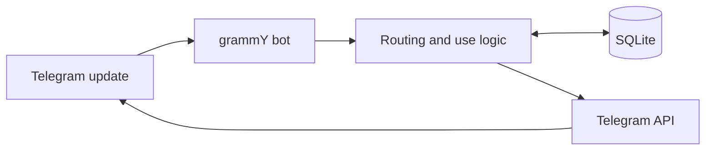
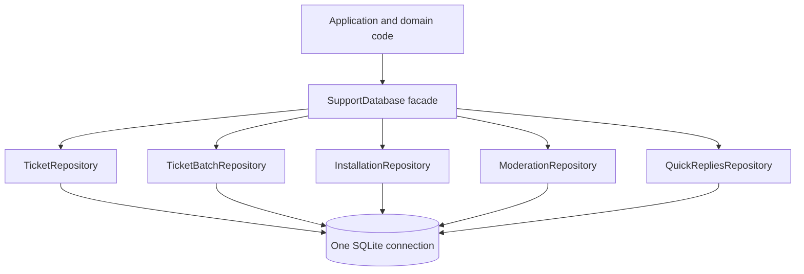
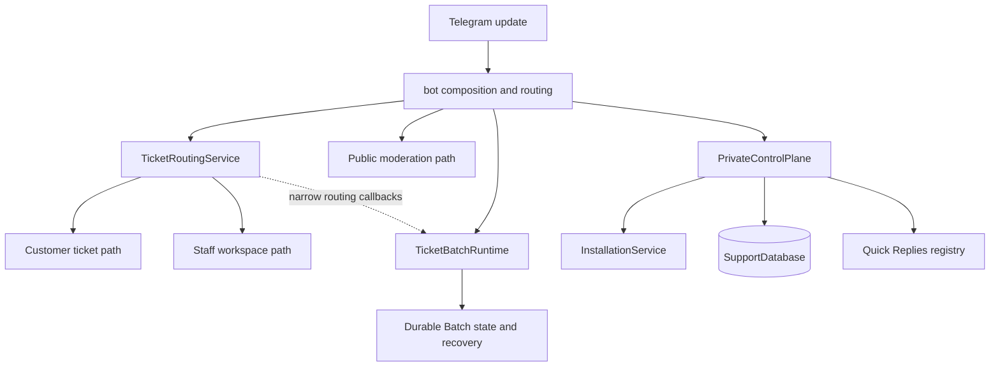
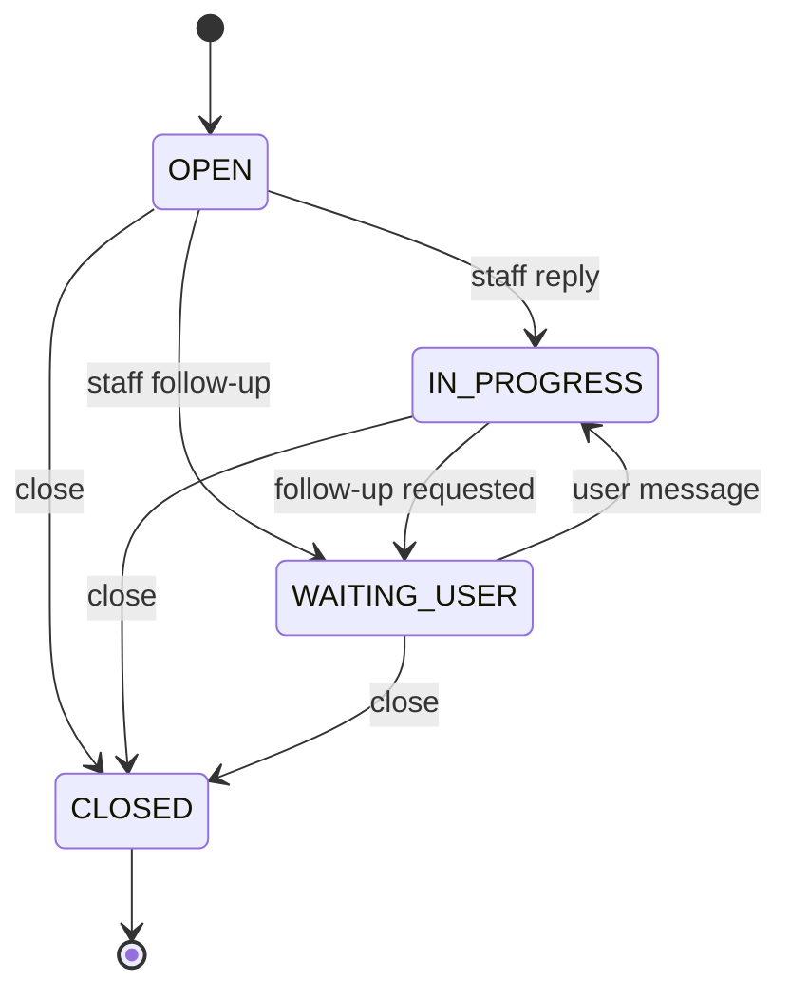
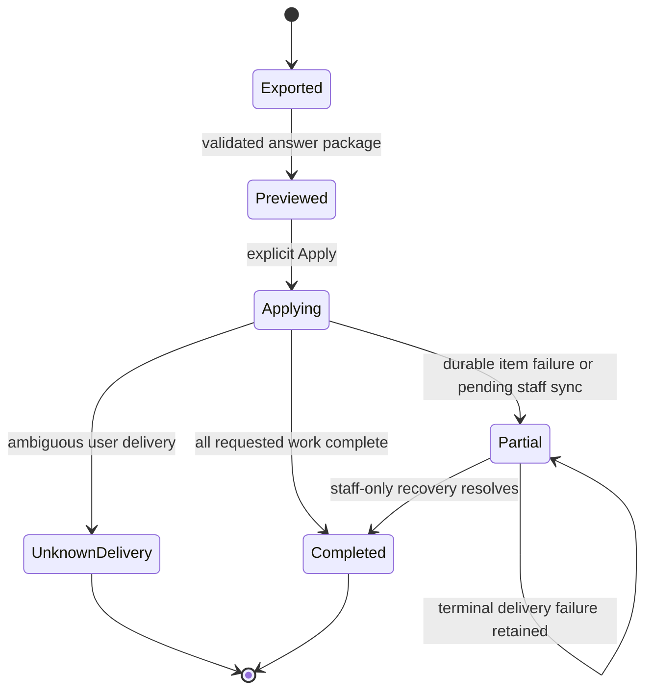
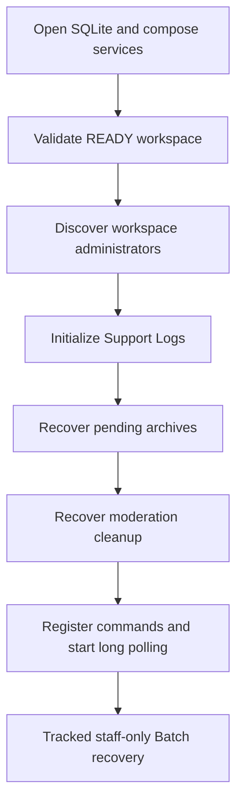

# Architecture

## Overview

This is a single-instance Telegram support service written in TypeScript. grammY receives Telegram updates, `createBot` composes routing and application services, and SQLite stores durable operational state. Telegram remains the system of interaction; SQLite supplies restart-safe state, idempotency, and recovery.

`src/index.ts` owns process startup: it loads configuration, opens `SupportDatabase`, initializes persistent Quick Replies and the installation service, composes the bot, then performs bounded ready-workspace archive/moderation recovery before long polling starts. Batch recovery begins after polling as tracked background work. `SupportDatabase` owns the single application better-sqlite3 connection, migrations, backup, and lifecycle. It remains the compatibility facade over concrete persistence domains.

The repositories are persistence-only modules. They share the connection owned by the facade, do not call Telegram, and do not close the database. Application consumers declare narrow structural `Pick<SupportDatabase, ...>` store types containing only the operations they need; composition supplies the same database instance. These types do not add another facade or connection. Repositories may import shared domain types, diagnostics, and policies; they must not depend directly on Telegram adapters or update handlers at runtime.

`src/bot.ts` is the grammY composition root: it wires middleware, command and callback registration, operator UI, and the application's services. It delegates customer-to-ticket and staff-topic-to-customer routing to `TicketRoutingService`, and delegates durable Batch Apply and recovery orchestration to `TicketBatchRuntime`. `PrivateControlPlane` owns private operator dashboard/navigation rendering, authoritative-screen lifecycle, stale callback rejection, editor and picker sessions, and callback/input dispatch for Team, public chats, moderation, Support settings, and Quick Replies. It deliberately remains grammY-aware because it is the Telegram adapter for OWNER and staff administration, while installation, Quick Reply, moderation, and Batch services retain their business state.

The extracted Telegram surfaces are `quickRepliesTelegram.ts` (picker/callback presentation), `ticketBatchTelegram.ts` (export, upload and preview wiring), and `publicModerationTelegram.ts` (public message/reaction orchestration and sanction failure containment). They receive explicit dependencies from `createBot`; registration remains at the established composition positions. Batch serialization stays in `ticketBatch.ts`, moderation policy stays in its domain modules, and entity-notification command glue remains in `bot.ts`.

`TicketRoutingService` owns customer ticket creation and continuation, staff-topic replies, transcript persistence, close/archive lifecycle, and the tightly coupled support-ban lifecycle. It reads the active staff workspace dynamically from `InstallationService`; Batch recovery passes an explicit workspace binding where an operation must remain attached to the workspace that created it.

Inbound routing journals source chat/message identity and each topic, summary, formatted-message, and required original-copy stage before Telegram side effects. Conditional SQLite claims and ticket status transitions prevent conflicting work; ordinary status transitions cannot reopen a CLOSED ticket. Interactive replies and archive summary/document delivery use their own durable claims. Ambiguous non-idempotent operations require Delivery Review proof, not automatic replay.

`TicketBatchRuntime` owns the persisted Batch Apply state machine, retry scheduling, delivery and `UNKNOWN_DELIVERY` handling, `silent_close`, staff-topic echoes and failures, archive continuation, and final-summary recovery. Its timers, queues, and export locks are instance-owned. It receives narrow callbacks from `TicketRoutingService` for user delivery, ticket refresh, and close/archive work; `TicketRoutingService` does not depend on `TicketBatchRuntime`.

`InstallationService` is the runtime source of truth for installation state, the active workspace, and RBAC. Background-task ownership and runtime observability are process-instance concerns: `BackgroundTaskRegistry` tracks detached durable work for lifecycle draining, and the runtime health components expose aggregate readiness, metrics, and bounded operational alerts without using process-global runtime state.

`RuntimeHealthEvaluator` samples read-only, workspace-scoped durable backlog aggregates after a successful database probe on its existing 60-second interval. `OperationalBacklogRepository` reuses review and Batch eligibility predicates; `OperationalBacklogRegistry` retains the last successful sample and its freshness. `/metrics` serves cached aggregates, and the existing alert coordinator evaluates fresh review-staleness and recovery-overdue conditions without creating another scheduler or retrying delivery.

## Ticket Lifecycle

Each active support ticket is scoped to one staff workspace and has one dedicated Telegram forum topic. User messages create or continue the ticket; staff replies and Quick Replies use the same delivery and transcript paths.

Closing archives a transcript through the existing Support Logs path. Ticket and archive records make restart recovery safe when a Telegram operation is interrupted.

## Batch Workflow

Ticket batches export active tickets as one ZIP and accept a validated answer package. Preview and Apply are explicit operator actions; durable package and item states prevent replaying successful delivery.

`UNKNOWN_DELIVERY` is conservative: when Telegram delivery may have happened but cannot be confirmed, the service records the ambiguity instead of blindly retrying and risking a duplicate user message. OWNER/ADMIN reconciliation records externally verified outcomes through conditional SQLite transitions and an append-only audit trail; it never replays the original send. Staff-only synchronization has its own durable retry state and can recover without resending user delivery.

## Startup and Recovery

For a READY installation with an active workspace, startup classifies orphan in-flight intents without resending and performs ordered archive/moderation recovery with a shared limit of 50 durable items or a 10-second soft budget, checked between items. Unfinished archive/moderation work stays durable for a later pass; there is no post-READY archive retry worker.

Migrations are idempotent and recorded in `schema_migrations`. The database uses SQLite WAL mode, allowing the single bot process to make durable transactional updates while supporting recovery after restart.

## Cross-Cutting Reliability

- **RBAC and installation state:** `InstallationService` manages setup state, owner pairing, team roles, workspace membership, and authorization mode. `PrivateControlPlane` tracks exactly one authoritative private operator screen and rejects callbacks from retired screens.
- **Moderation:** managed public chats retain independent configuration. Violations, sanction cycles, and cleanup jobs persist; warnings are topic-aware while sanctions remain chat-wide.
- **Batch idempotency:** stable package/item identities, delivery diagnostics, and staff-only retry records prevent duplicate replies, transcripts, archives, and topic events.
- **Delivery taxonomy:** Telegram failures are normalized into actionable categories and permanence. Confirmed permanent failures are not automatically retried; ambiguous operations use `UNKNOWN_DELIVERY`.

## Deliberate Tradeoffs and Future Direction

The application favors a compact single-process deployment: `createBot` is still a large composition closure, and the `SupportDatabase` facade intentionally remains the public persistence entry point even though SQL implementation is now separated by domain. The extracted private control-plane and persistence boundaries do not attempt to redesign product flows. Some short-lived interaction state, such as active picker or input sessions, remains in memory while durable business outcomes are persisted in SQLite. These choices reduce moving parts for the current operating model, but they make navigation and future scaling harder.

The intended direction is incremental extraction behind existing seams, not a rewrite: keep focused application modules and narrow database consumers, and persist only interaction state that demonstrably needs restart durability.

## Architecture Guardrails

`npm run architecture:check` runs a deterministic, read-only Node/TypeScript check in CI. The baseline was measured on 2026-10-20 at `a545aec0039666dbe2508b0b11b8ec3958e92904`: 51 production TypeScript modules, 121 local runtime dependency edges, and no runtime cycles. The composition roots are `index.ts` (process/lifecycle) and `bot.ts` (Telegram), with setup, owner, and backup CLI entry points.

New modules and existing modules below the threshold have an 800-physical-line limit, including blank lines and comments. CRLF and LF count identically; a trailing newline is not an extra line. Existing larger modules have explicit budgets with 25 lines of headroom:

| Module                                 | Baseline Lines | Limit |
| -------------------------------------- | -------------: | ----: |
| `src/db.ts`                            |           2418 |  2443 |
| `src/privateControlPlane.ts`           |           2010 |  2035 |
| `src/bot.ts`                           |           1960 |  1985 |
| `src/persistence/ticketsRepository.ts` |           1822 |  1847 |
| `src/ticketBatch.ts`                   |           1523 |  1548 |
| `src/ticketBatchRuntime.ts`            |           1244 |  1269 |
| `src/publicModerationTelegram.ts`      |            968 |   993 |
| `src/ticketRouting.ts`                 |            897 |   922 |
| `src/ticketBatchTelegram.ts`           |            858 |   883 |
| `src/archive.ts`                       |            847 |   872 |

The checked-in policy is `scripts/architecture-baseline.json`; CI never regenerates it. Grandfathered budgets cannot increase or be added. A module smaller than its recorded baseline requires a manual decrease of both `baselineLines` and `maxLines` (the latter always equals baseline plus 25), or removal of its exception. The checker compares the previous committed baseline; CI checks out full history for that ratchet. Do not refactor application code solely to manipulate line counts.

The checker captures full-program TypeScript JavaScript emit in memory for dependency analysis, resolves local module specifiers using `tsconfig.json`, and checks runtime imports, re-exports, literal dynamic imports and `require` calls. Nothing is executed or written. Type-only dependencies, including implicit interface re-exports erased by the compiler, do not create runtime cycles. Computed module loads fail the check because they cannot be resolved statically. This is a module dependency guard, not whole-program data-flow analysis or a security sandbox; TypeScript/build checks remain required.

Persistence modules cannot directly depend at runtime on grammY/plugins, the composition/update handlers, the private control plane, or `*Telegram` surfaces. The named restrictions also cover entity-notification, Batch and moderation orchestration. Shared domain policies, diagnostics and type imports remain valid. Runtime SQLite-driver dependencies are restricted to `db.ts` and the existing `backups.ts` read-only integrity verifier, which opens an isolated backup/restore candidate. Repository database types and injected connections remain allowed. No runtime cycles are grandfathered: every detected cycle fails the check.

Revalidate the budgets and named adapter/ownership restrictions when introducing a module, changing a dependency, or changing a connection owner. Future exceptions must be explicit, narrow and justified in the change review; these checks do not replace review of side-effect ordering or durable state semantics.
